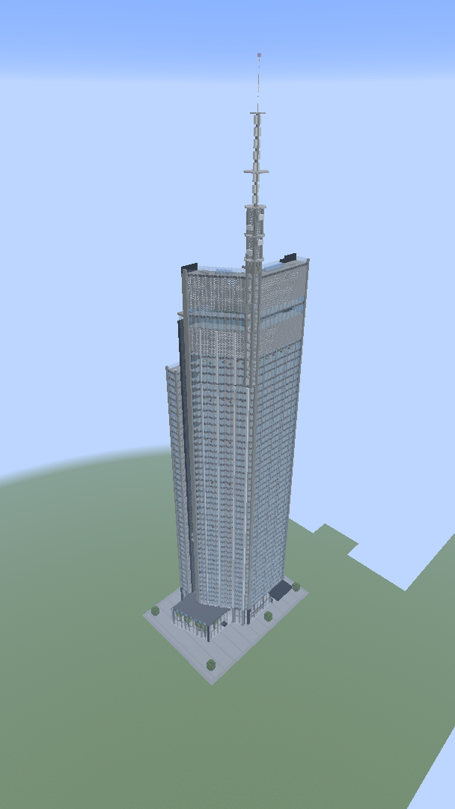

# PlanCraft

**Real buildings. Minecraft worlds.**

Recreate real architecture in Minecraft from a building's name, plans or photographs.
PlanCraft combines a **Copilot-guided research and modelling workflow** with deterministic
tools and real-game verification to produce detailed, explorable structures at
approximately **1:1 scale**.

Research the building, model the whole structure, compile it, paste it in one go, and
inspect it in a real Minecraft world. No block-by-block construction in the game.

## Real buildings

Varso Tower in Warsaw demonstrates the workflow: 53 storeys, glazed facades, cores,
stairs, landscaped terraces and the 310 m spire. The occupied model spans
94 × 311 × 68 blocks and contains 190,392 non-air blocks.

| Varso Tower, Warsaw | Recreated with PlanCraft |
| :---: | :---: |
|  |  |

Real photo: [Anty000, Wikimedia Commons](https://commons.wikimedia.org/wiki/File:Varso_Tower_Warsaw_22(cropped).jpg),
[CC BY-SA 4.0](https://creativecommons.org/licenses/by-sa/4.0/) (Commons' cropped version,
resized thumbnail; no further edits). Minecraft screenshot: actual in-game review, cropped
to remove excess sky; the complete building is preserved. The views show different sides.

**[Download and paste Varso Tower](buildings/README.md)** into your singleplayer world or
server. The shared project includes the editable model, generator and complete build JSON;
no Copilot session, compilation or website upload is needed to paste the supplied file.
Read its height instructions first: the full tower does not fit at sea level under the
default Overworld ceiling.

## How it works

```text
research -> model -> compile -> paste -> inspect -> refine -> approve -> deploy
```

- **Research:** collect public plans, dimensions, materials and photographs, or use your
  own references. Record sources, measurements and assumptions.
- **Model:** describe the complete building in centimetres using YAML and a material
  palette, including rooms, openings, stairs, facade details and roofs.
- **Compile:** deterministic Python tools turn the model into blocks, validate it and
  generate previews. The same model and palette produce the same blocks.
- **Inspect:** paste the complete structure into a fresh real Minecraft world, read it
  back cell by cell and review exterior and interior screenshots against the references.
- **Refine and deploy:** improve the model rather than editing blocks by hand. After
  approval, prepare a walkthrough or paste into an existing world, rehearsing on a copy.

One block represents one metre. Minecraft's grid and available sources limit fidelity:
uncertain interiors and simplified geometry must be disclosed, not presented as exact
copies. See the [toolchain guide](tools/building/README.md) for model formats, PDF helpers,
quantisation, reviews, height checks and deployment tools.

## Use with GitHub Copilot

The intended end-to-end workflow pairs **Copilot's research, modelling and visual review**
with **deterministic compilation, placement and read-back checks**. The command-line tools
do not find or interpret a building by name on their own; the LLM uses the bundled skills
to turn references into the model that those tools compile.

1. Open this repository in VS Code with GitHub Copilot Chat in **Agent mode**.
   Follow the [toolchain setup](tools/building/README.md#setup): Python 3.11+, its listed
   dependencies, and Java 25 for the real Minecraft review client. Allow access to public
   sources, local commands and screenshots when prompted.
2. Use the bundled skills; no additional skill pack is required:

   | Skill | When to use it |
   | --- | --- |
   | [real-building](.github/skills/real-building/SKILL.md) | Research, source measurements, YAML model and materials, compilation, real-game review, refinement and approval. |
   | [deploy-build-to-server](.github/skills/deploy-build-to-server/SKILL.md) | Put an approved build into an existing world: check versions and height, rehearse on a copy, and prepare the files and paste commands. |

   Ask Copilot explicitly to use the skill by name. If it is not discovered automatically,
   attach the linked `SKILL.md` to the chat and ask Copilot to follow it.
3. Start with a request such as:

   > Use the real-building skill to recreate Varso Tower in Warsaw at 1:1 scale.
   > Research public plans, dimensions, materials and interior references. Prepare the
   > complete model, compile it and paste it in one go into a fresh real Minecraft world.
   > Compare the read-back and screenshots with the references, then refine it.
   > Do not upload it or modify my existing worlds until I approve.

4. Review measurements, source assumptions, validation, read-back and screenshots with
   Copilot. Request a playable walkthrough if useful, then iterate on the model.
5. After approval, use `deploy-build-to-server` for a local paste, or explicitly approve
   an online upload. Back up existing worlds and rehearse on a copy before deployment.

You can also author models and run the tools manually; an LLM is not a runtime dependency
of the compiler or placement backend.

## Start here

| Goal | Guide |
| --- | --- |
| Paste an included building into your game | [Buildings and installation steps](buildings/README.md) |
| Create or edit a model | [Toolchain setup and commands](tools/building/README.md) |
| Install the current Minecraft backend | [Installation and dependencies](docs/buildpaste.md#installing) |
| Check game versions | [Backend compatibility](docs/buildpaste.md#supported-versions) |
| Build the backend from source | [Build instructions](docs/buildpaste.md#building-from-source) |

## BuildPaste integration

PlanCraft's current placement backend is derived from MistrX's **BuildPaste** plugin and
supports local build files, undo and optional buildpaste.net transfers. Website uploads
are not required for local use; [integration documentation](docs/buildpaste.md) covers
commands, installation, compatibility and upstream history. PlanCraft is independent of
and not endorsed by MistrX or the BuildPaste service.

## Privacy

Only the public Varso example is allowlisted in `buildings/`; other projects remain
gitignored. Private home plans and their derived builds must not be published without
explicit permission.

Sharing private plans with your chosen LLM service is a separate decision: gitignored
files are not automatically private from tools given access to them.

## Credits and licences

The code is licensed under the [MIT licence](LICENSE). Upstream backend credits are
preserved in the [integration guide](docs/buildpaste.md#credits-and-licences); the photo
above has its own attribution and licence.

The icon is **not** covered by MIT. It is
["Minecraft Windows 11 Folder ICO PNG" by SimplexDesignss](https://www.deviantart.com/simplexdesignss/art/Minecraft-Windows-11-Folder-ICO-PNG-950630441),
used under [CC BY-NC-ND 3.0](https://creativecommons.org/licenses/by-nc-nd/3.0/).
It is redistributed unchanged: it must not be resized, recoloured or otherwise altered,
and must not be put to commercial use. Its notice also travels inside the backend jar
at `assets/buildpaste/ICON-LICENSE.txt`.

Dedicated to my son, who would rather spend an afternoon building a castle than fighting
anything that lives in one :)
